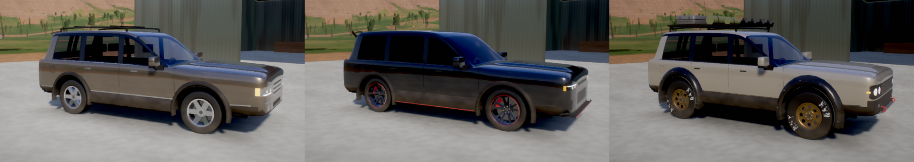

# Dirt Sleeper

A driving game about one truck: an original, fictional mid-2000s luxury SUV that you build into a
dirt-drag sleeper, a mud rig, or both, on a ranch with a dirt strip, a trail loop, a hill climb and
a mud pit.

The truck has a tall, square face, hips over both axles, a raised centre on the hood and textured
cladding around the arches and along the rockers. Three finished looks go on in one click from the
shop's **Looks** tab:

- **Classic Sleeper**: bronze-grey, chrome twin-bar face, six-spoke alloys, the factory lip.
- **Street Sleeper**: gunmetal, lowered on 20-inch ten-spokes with red calipers, split-mesh face,
  smoked lamps, LED ring tails, splitter, diffuser, roof spoiler and red pinstripes.
- **Backcountry**: canyon stone on bronze discs and all-terrains, quad round lamps in a slatted
  black panel, wide bolted flares, recovery shackles and an expedition rack.



- **Campaign**: start with $2,500 and a stock truck, beat seven drag racers, earn medals and fill a
  16-trophy case.
- **Free play**: every part, racer and run unlocked, no prices.

Everything runs in one HTML file with no dependencies: WebGL2 graphics (from the Shiftlight 3
renderer), live engine sound (from Digital Engine), and a live-synthesised environment.

## Build

```sh
./build.sh
```

This writes two pages, each as the page body (as published) and as a `.local.html` full document
you can open straight from disk:

- `dist/dirt-sleeper.html`: the game.
- `dist/sound-board.html`: the sound board. Pick a scene (shop, trail, strip at night, creek,
  storm, mud bog), switch versions of each sound, set levels against the engine at idle or redline,
  then copy the mix code into the game under Settings → Sound mix.

## Layout

| Path | What's in it |
| --- | --- |
| `src/10`–`15` | Renderer, car shader pipeline, particles, maths, engine DSP and engine specs (from Shiftlight 3 and Digital Engine) |
| `src/20`–`22` | Tyre model, powertrain and vehicle physics |
| `src/30`–`34` | Input, game audio (tyres, ground, buses, loudness, limiter), the ambience synth and the shared mix |
| `src/40`–`41` | The ranch: terrain, strip, trails, shop, and their materials |
| `src/50`–`51` | The truck's mesh, bolt-on parts and paint shader |
| `src/60`–`61` | The parts catalogue and how a build becomes an engine, a chassis and a look |
| `src/70`–`90` | Game flow, events, rivals, trophies, UI and boot |
| `src/95` | The sound board |
| `shell/` | The page shells: title, styles, markup |
| `tools/` | Node and Playwright checks: mesh winding, drag estimates, autopilot runs, audio renders, screenshots (`truck_shots.py` renders the looks from several angles) |

## Controls

W/↑ gas · S/↓ brake (hold to reverse) · A D steer · Space handbrake · Shift nitrous · L low range ·
K lockers · F light bar · H horn · C camera · R flip/reset · Esc pause. Gamepads and touch work too.
