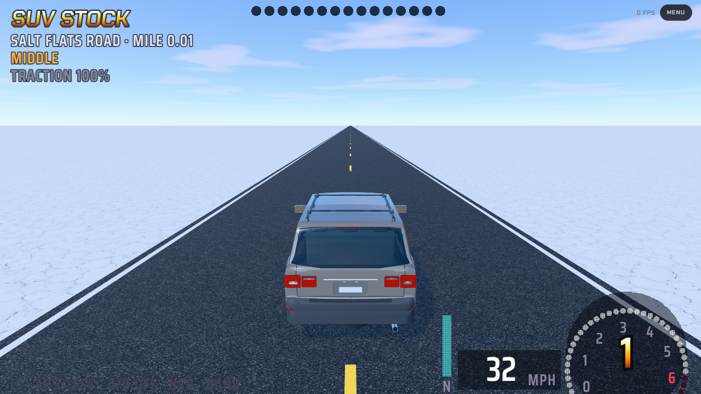
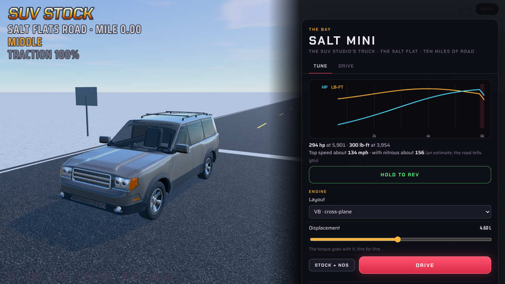
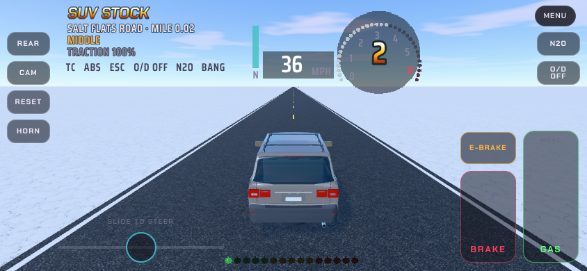

# Redline County: Salt Mini

**Salt Mini** (the folder `salt-mini/`, the page `salt-mini.html`): a small standalone page. The SUV Studio's full
truck (`../suv-studio/`, about 484 000 triangles with its wheels) on Road Not Found + Traffic's own physics, driven
exactly as in SUV: Super Unlimited Venture (`../suv-venture/`): the same physics setup, controls and driving level.
It sits on a bare salt flat with a ten-mile road across it, in Road Not Found + Traffic's own clothes:
its HUD, keys and touch controls, its cameras, its traction setting and the Digital Engine's sound, with the bay
(the Tune sheet) as its menu.

Open `salt-mini.html` in a browser with WebGL2 (one self-contained page, about 2.5 MB with the game's typefaces). `sh build.sh` rebuilds it
(run `npm ci` in this folder once first).

## Driving: Road Not Found + Traffic's own controls and HUD

- **The HUD** is the game's own (its `61_hud`, `20_instruments` and `10_core`, in `src/ui/`). It's drawn in the
  game's dots over the picture (its dot shader, as a three.js pass) with its words in the game's typefaces. It
  shows the truck and its build, where it is on the road, the driving level and the traction; Shiftlight 2's shift
  lights, the tach and gear, and the speed in seven-segment figures with the boost and nitrous bars; the chips (TC,
  ABS, ESC, O/D OFF, N2O, BANG); and messages.
- **Keys** (the game's): W/S or the arrows, A/D, Space for the e-brake, E/Q to shift, N or Shift for nitrous,
  H horn, L low range, K lockers, O overdrive off, C camera (Chase, Far, Hood), G look behind (held), T traction,
  I engine on and off, R back to the start, F numbers, Esc or P the menu. 1 to 9 is part gas. W is all or nothing,
  as in SUV.
- **Phone** (the game's touch controls): slide to steer on the left (or tilt, or two buttons), and a tall gas pedal
  where how high your thumb sits is how much gas. Brake and e-brake beside it. REAR, CAM, RESET and HORN down the
  left; N2O, LOW, LOCK and O/D OFF down the right, each only when the truck has one; Menu at the top.
- **It drives exactly as in SUV**: the same physics setup, the same input rates, Middle to start, and the traction
  at 100%.
- **The road**: 10 miles of two-lane blacktop running straight out from the start line, with white edge lines, a
  yellow dashed centre line, and a bar across the road with a sign at the start, the quarter mile and every mile.
  The salt runs on forever and uses the game's salt-flat surface (its `strip`), a little looser than the road.
- **NOS** is the physics' own nitrous. A bottle lasts eight seconds and refills by itself in about twelve while
  you're off it. The page starts with a 125-shot fitted.

## Traction (the game's developer panel)

The game's T key steps the traction 100 → 150 → 200% and back; the HUD says where it is. The Drive tab has the
panel's sliders: the traction (every surface at once, 50 to 200%) and the handling knobs (back-end grip, grip once
sliding, steering at speed). At 100% the ground is exactly SUV's, which drives looser than the county (the county
plays at 200%).

## The engine's sound

The Digital Engine, as the game has it (`17_audio`): the synth in an audio worklet, off the page's own thread,
heard from the bay's spot 3 m behind. It starts with the first tap or key (a browser won't play sound before
that). It has the horn, the pops (the BANG chip), the turbo and the nitrous. Volume and the speaker's tone are in
the Drive tab.

## The menu: the bay

Menu (or Esc or P) stops the truck where it stands, swings the camera round it and opens one card in the game's
look, with two tabs.

- **Tune**: the game's Tune sheet, all of it, the sound rows included (knock and clatter, pulse length, roughness,
  pipe length, pops, blow-off, straight-cut gears, launch control, the limiter). It also has the Plus tune and the
  final drive. A dyno chart, the peaks and a top-speed estimate sit above the rows, and **Hold to rev** lets you
  hear the engine as tuned.
- **Drive**: the driving level, the traction and handling, the phone's steering, and the sound.

Every engine change goes through the game's own path (`16_engines` `engineSpec` with the sheet's keys), with the
sheet's rules. Press **Drive** and the truck is rebuilt with the new engine where it stood. Everything is kept in
this page's own save (`sm-mini`; the sound's settings in `sm-engine`).

The top-speed estimate was checked against full-throttle runs on the road:

| Tune | Peak | Estimate | Measured |
|---|---|---|---|
| Stock + 125 shot (no NOS used) | 294 hp | 134 mph | about 132 mph |
| 9 L twin turbo, 2.5 bar, 9,000 rpm, final drive 2.2 | 2,237 hp | 271 mph | 266–273 mph |
| The same at 3.5 bar, 10,000 rpm, final drive 2.0, Plus × 2 | 6,185 hp | 366 mph | 360–362 mph |

Past about 300 mph the tyres, not the engine, are the limit (at 100% traction). The truck runs dead straight at
every speed.

## What it's made of

- `src/game`, `src/drive`, `src/hd`: copies from SUV: Super Unlimited Venture. The physics (`40_physics`,
  `41_ground`, `42_chassis`, `43_sim`, `44_ai`, `45_ev`, `15_digital_engine`, `32_builds`, `37_newbuilds`,
  `34_machines`) is unchanged, except that `16_engines` and `43_sim` use this page's save keys (`sm-tune`, `sm-sim`).
- `src/mini/91_kit.js`: what the page takes from the game's code, including the tuner's way into `engineSpec` and
  `plusSpec`.
- `src/mini/main.js`: the page. It has the sky with the sun behind the truck, the salt (one big square that follows
  the truck, with the picture laid at three sizes so it doesn't visibly repeat), the road and its signs, the truck,
  the chase camera (kept round the truck so it never falls behind, a little wider with speed and on nitrous), the
  controls and the bay.
- `src/ui/`: the game's HUD (`10_hud` from its `10_core`, `20_instruments`, `61_hud` from its drawHud) and its engine
  sound (`17_audio`), copied, with only their save keys renamed. `src/mini/tuner.js`: the bay's sheets, chart and estimate.
  `src/mini/mats.js`: SUV Studio's materials.
- `src/mini/49_ground.js`, made by `tools/pack_ground.py`: the salt (the owner's playa picture, turned grey and
  lifted toward white) and the county's asphalt.
- `tools/shot.js`: headless pictures and numbers (`node tools/shot.js /tmp/mini 'run=MINI.step(10,{thr:1})'`).

## Next

Whatever the owner asks for next.
